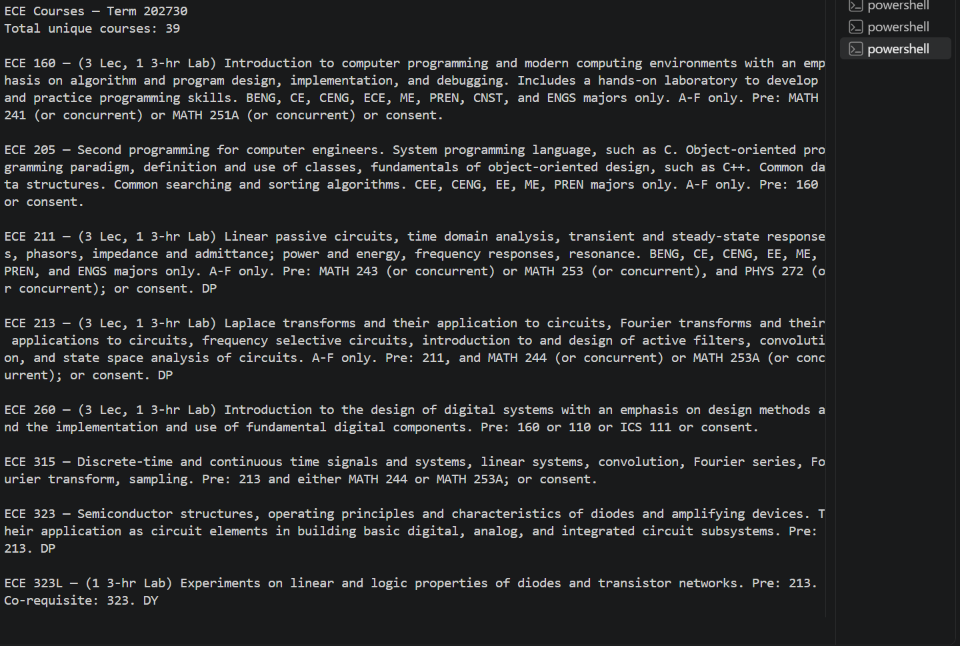

# Overview

TEMP NAME is a service that allows students to easily search for classes they are eligible to take. Rather than sifting through STAR GPS, students can upload their transcripts and instantly see which courses they qualify for.

## Proposers

- Jenna Harrison
- Evan Morgan
- John Leevi Domingo
- Charles Thompson

## Mockup Page Ideas

To use TEMP NAME, a user must create an account. Their profile allows TEMP NAME to securely store and access their uploaded transcripts. Using the uploaded transcripts, users can view their academic history and see which classes they are eligible to take.

### Planned Pages

- **Register Page:** Allows new users to create an account.
- **Login Page:** Allows existing users to log in.
- **Landing Page:** Welcome page with navigation tabs to access the application's functionalities.
- **Search Classes Page:** Allows users to search for eligible courses.
- **Course Display Page:** Displays available courses that the user is eligible to take, along with relevant course information.

## Proof of Concept

## Use Case Ideas

- A new user creates an account.
- An existing user logs in.
- A user uploads their transcript.
- A user views their uploaded transcript.
- A user searches for courses they are eligible to take.

## Beyond the Basics

After the basic functionality is complete, the following advanced features may be considered:

- Sort classes by professor.
- Rate professors.
- Filter classes by campus and semester.
- View previously uploaded transcripts.
- Upload updated transcripts.
- Manage account information:
  - Change password.
  - Change email address.
  - Update profile picture.
